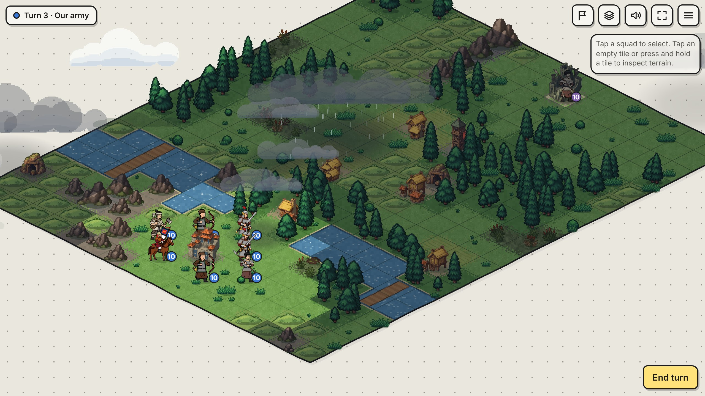
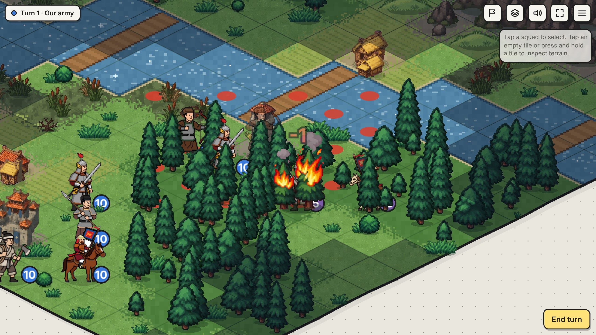
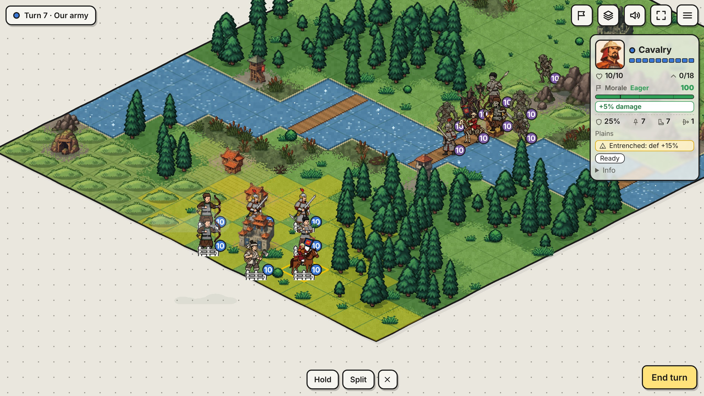
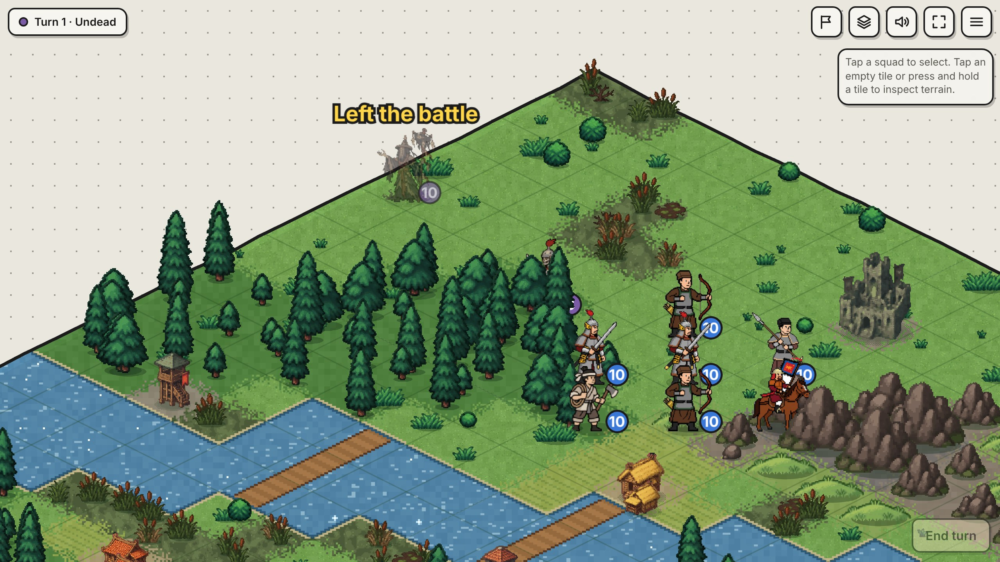
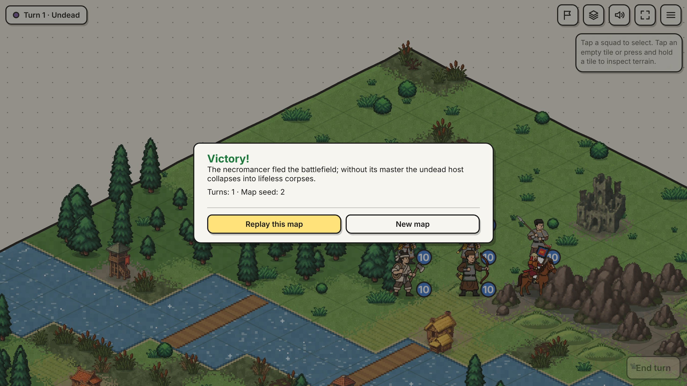
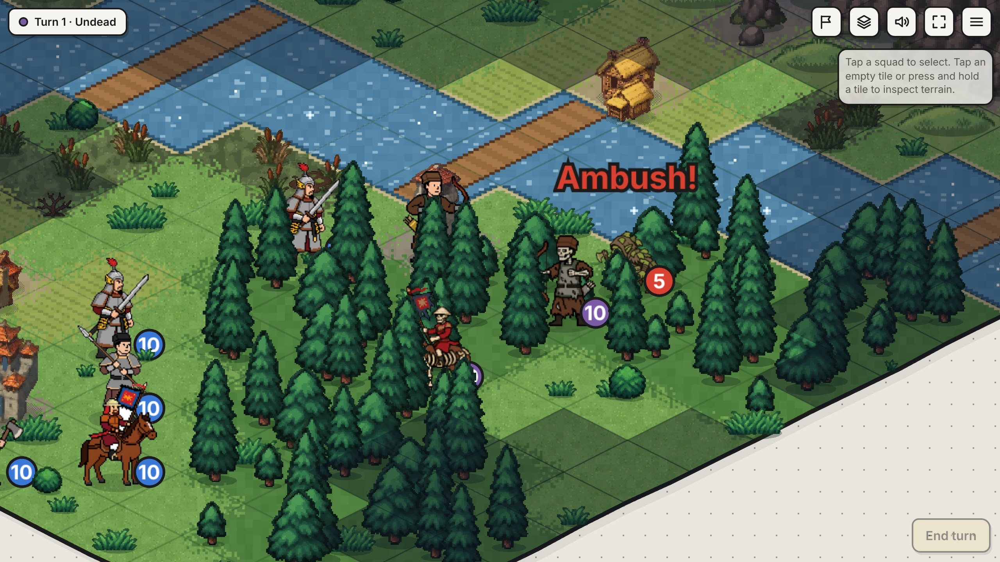

# Devlog #2: Rain, burning forests, and an undead host that thinks

Hi everyone, it has been a while since the first playtest build. The battlefield of **Doodle Battlefield** has changed a lot this round: there is weather, fire, fog of war, and the Undead faction has been rewritten almost from scratch. This post goes through each of them, with a few numbers I measured along the way.

## Weather: controlled chaos

In the last devlog I said there are no dice in combat. That is still true. But the battlefield does not have to stand still.

- **Wind** blows in one of 8 directions and rarely changes.
- **Dark clouds** drift slowly across the map with the wind. About a quarter of the big ones are raining.
- **Rain** turns plains into **swamp** for 2 turns: slow going, lower defense and damage. Cavalry can still enter a swamp, but they bog down badly.

Weather does not decide battles, but it makes you look at the sky before sending cavalry across an open field.

## Fire arrows

Human archers can now shoot **fire arrows** into a forest tile in range. Whatever stands there takes a normal shot, then gets scorched on top. The forest burns for 2 turns and becomes **burnt forest**: bare like a plain, with no cover left. Fire can **spread downwind**, and rain puts it out. Each archer waits 3 turns between fire arrows.

This is the human answer to the Orcs, who treat forests as home. If you want Orcs out of the woods, burn the woods.

## Fog of war

Every squad sees 3 tiles. Archers see 1 tile farther, standing on a hill or watchtower adds 1, a low mountain adds 2. Beyond your sight you still see the terrain, but not the troops.

- Orcs standing in a forest that have not shown themselves appear only as a **dark shadow with a "?"**: you know something is there, not what it is.
- Goblins stay fully invisible. Ambushes are their specialty.
- Walking into a unit hidden in the fog stops your squad right in front of it.
- Shooting from inside the fog gives away your position until the end of the enemy's next turn.

The AI plays fair: it only knows what its troops can see. This round it also **remembers** where it last saw your troops, for 3 turns, the same way any player would. Fog and weather can both be toggled in the menu.

## The Undead, rewritten

This is where most of the time went.

### The problem

The easiest way to beat the Undead in the previous build was to dig in, wait for them to walk into bow range one by one, and shoot them down. The old AI just kept walking in. I wrote a "turtle" bot that plays exactly like that and let it fight the Undead: the turtle won most games.

Digging deeper, the root cause turned out not to be the AI but the rules: the Undead are **1 tile slower than humans**. If they stand outside your reach, they cannot reach you in one turn either. "Gather up and charge together" sounds good, but in practice it still means stepping into range and taking the first hit.

### The necromancer's will

The Undead have no will of their own; they are the necromancer's puppets. And the necromancer only wants two things: **to win, or to stay alive**. Every turn the whole host picks one stance:

- **Probe:** in the fog, not knowing where you are, the cheapest unit scouts ahead and the rest follow as a block.
- **Press:** when clearly stronger, even after counting your hills and fortifications, they gather and charge in the same turn.
- **Stand off:** if you are dug in too well, they **stop just outside your reach** and will not step in. Any squad of yours that leaves its position to attack gets hit by the whole host. If both sides sit tight, the battle stalls. To win, you have to come out.
- **Hold the graves:** when weaker but with graves still counting down, they fall back around the graves to stop you from laying the dead to rest, and wait for fresh troops to rise.
- **Huddle:** when weaker and out of graves, they pull back to shield the necromancer.

To avoid pressing one turn, retreating the next and pressing again after that, every stance lasts at least 2 turns, and the bar to start pressing is higher than the bar to keep pressing.

### Hitting as hard as the living

The Undead used to deal 18% less damage than in life and outnumber humans by 2 squads. After measuring, it became clear that **damage is the real difficulty lever**: stances change *how* the Undead fight, damage changes *who wins*. In this build the Undead hit as hard as they did alive and outnumber you by just 1 squad. They are still slow, still have no morale, and still live off the graves.

Against the turtle bot on small maps, the Undead went from winning about a third of games to even. Against an AI that plays normally, they are only slightly stronger.

### The necromancer runs

Once there is no way back (almost no troops left, fewer than half of yours, no graves about to rise), the necromancer **abandons his stronghold and runs** for the map edge. Catch and kill him and you win. Let him escape and the host loses its master and collapses: you win too, just sooner.

### The whole map is cursed, and "Bury the fallen"

Graves now **count down anywhere on the map**. Within 12 tiles of the necromancer they rise after 2 turns; farther away, after 4. Every grave shows its countdown. In the Vietnamese version, the action that stops them is now called *Cầu siêu*, a prayer that lets the fallen soldiers' souls go free.

## Wild goblins

Goblins are only allies of living Orcs. In a battle against the Undead there are no Orcs to follow, so **goblins attack anyone who walks into their forest**, human or undead.

- Like dangerous beasts, you will not always meet them: each large forest has about a **40%** chance of holding a goblin band.
- At the end of every turn, goblins ambush whoever is standing in their home forest. They never leave it.
- Humans killed by goblins still leave graves, so the Undead profit too.

## Smaller things

- **Tutorial, lesson 1:** moving, reading terrain, previewing an attack, attacking and ending the turn, about 3 minutes.
- Idle squads now have a **breathing animation** by default.
- Fixed the AI occasionally standing still for a whole turn for no reason, and the enemy turn banner saying "The Orcs are moving" while fighting the Undead.

## Coming up

- Tutorial lessons 2–4: terrain and morale, special units, the Undead and burying the fallen
- Campaign mode: a chain of battles where you carry elite squads forward, and a necromancer who fled comes back for revenge
- More balancing for Hold out under fog of war

## I need you

Especially for the Undead: do they feel smart? Is there anything silly they do, or a way to beat them that is too easy? Did you run into a stalled battle where both sides sat tight, and did that feel fine or annoying? Every comment gets read.

Thanks for playing!
