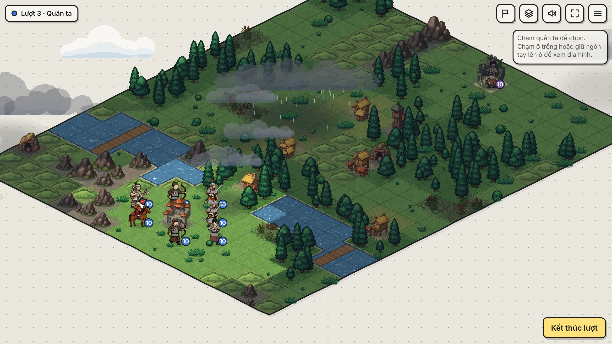
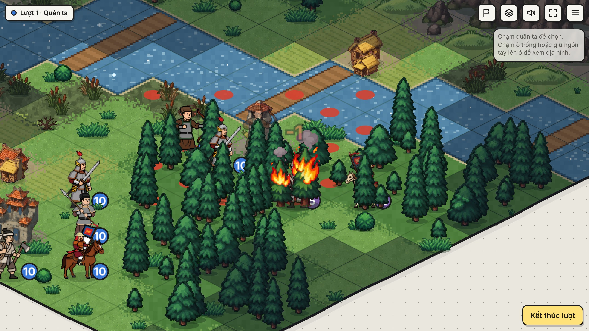
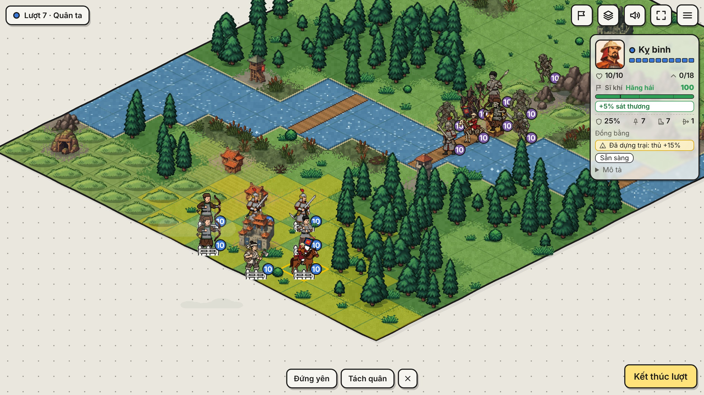
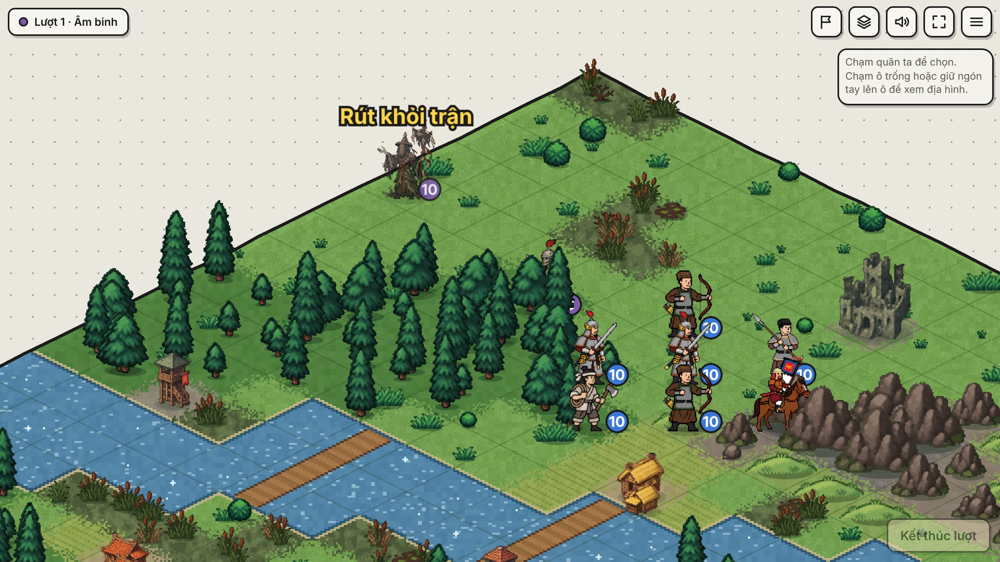
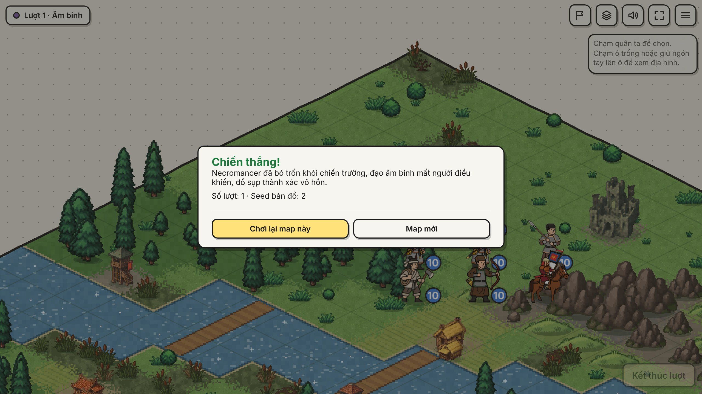
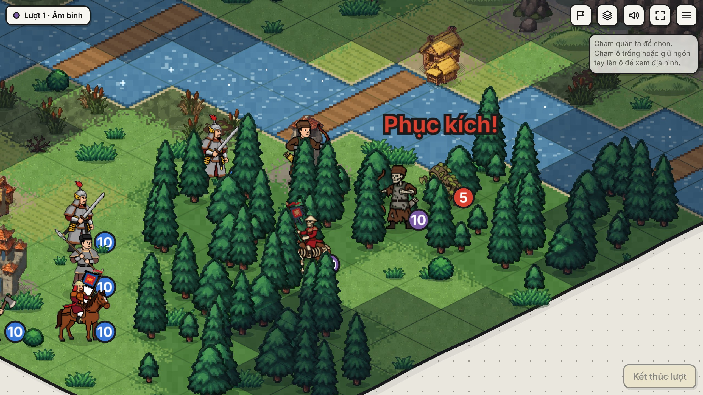

# Devlog #2: Trời mưa, rừng cháy, và một đạo âm binh biết suy nghĩ

Chào mọi người, đã một thời gian kể từ bản chơi thử đầu tiên. Đợt này chiến trường của **Chiến Địa Doodle** thay đổi khá nhiều: có thời tiết, có lửa, có sương mù, và phe âm binh được viết lại gần như từ đầu. Bài này kể lần lượt từng thứ, kèm vài con số mình đo được.

## Thời tiết: may rủi có kiểm soát

Devlog trước mình nói game không có xúc xắc trong chiến đấu. Điều đó vẫn đúng. Nhưng chiến trường thì không cần đứng yên.

- **Gió** thổi theo 8 hướng và hiếm khi đổi.
- **Mây đen** trôi chậm theo gió qua bản đồ. Khoảng một phần tư số đám mây lớn đang mưa.
- **Mưa** biến đồng bằng thành **đầm lầy** trong 2 lượt: đi chậm, giảm thủ và sức đánh. Kỵ binh vẫn vào được đầm lầy nhưng sa lầy rất chậm.

Thời tiết không quyết định trận đánh, nhưng nó buộc bạn nhìn lên trời trước khi cho kỵ binh xung phong qua cánh đồng.

## Hỏa công

Cung thủ phe người giờ có thể bắn **tên lửa** vào một ô rừng trong tầm. Quân trong ô đó ăn một phát bắn như thường, rồi bị lửa táp thêm. Rừng cháy 2 lượt rồi thành **rừng cháy trụi**, trống trơn như đồng bằng, không còn chỗ ẩn nấp. Lửa có thể **lan xuôi gió**, và mưa sẽ dập tắt nó. Mỗi cung thủ phải chờ 3 lượt mới bắn được tên lửa tiếp.

Đây là câu trả lời của phe người cho Orc, phe coi rừng là nhà. Muốn lôi Orc ra khỏi rừng thì đốt rừng.

## Sương mù chiến tranh

Mỗi quân chỉ nhìn được 3 ô. Cung thủ nhìn xa hơn 1 ô, đứng trên đồi hay tháp canh thêm 1 ô, trên núi thấp thêm 2 ô. Ngoài tầm nhìn, bạn vẫn thấy địa hình nhưng không thấy quân.

- Orc đứng trong rừng mà chưa lộ chỉ hiện ra là một **bóng đen có dấu "?"**: bạn biết có thứ gì đó ở đó, nhưng không biết là gì.
- Goblin vẫn tàng hình hẳn. Phục kích là đặc sản của chúng.
- Đi đâm vào quân khuất sương thì quân bạn dừng lại ngay trước nó.
- Bắn từ trong sương thì bị định vị, đối phương thấy bạn ở đâu cho tới hết lượt sau.

AI cũng chơi công bằng: nó chỉ biết những gì quân nó nhìn thấy. Đợt này AI còn **nhớ** chỗ nó thấy quân bạn lần cuối, trong 3 lượt, như một người chơi bình thường vẫn nhớ. Sương mù và thời tiết đều bật/tắt được trong menu.

## Âm binh, viết lại

Đây là phần mình dành nhiều thời gian nhất.

### Vấn đề

Cách thắng âm binh dễ nhất ở bản trước là ngồi thủ chắc, chờ âm binh lần lượt đi vào tầm cung rồi bắn từng con. AI cũ cứ thế lao vào. Mình viết một con bot "rùa" chỉ để chơi đúng kiểu đó và cho nó đánh với âm binh: bot rùa thắng phần lớn số ván.

Khi đào sâu, mình tìm ra gốc rễ không nằm ở AI mà ở luật: âm binh **chậm hơn người 1 ô**. Đứng ngoài tầm đánh của quân người thì âm binh cũng không với tới quân người trong một lượt. Kế hoạch "gom quân rồi cùng xông vào" nghe hay nhưng thực ra vẫn là tự bước vào tầm và ăn đòn trước.

### Ý chí của necromancer

Âm binh không có ý chí riêng, chúng là con rối của necromancer. Và necromancer chỉ muốn hai thứ: **thắng, hoặc giữ mạng**. Mỗi lượt, cả đạo âm binh chọn chung một thế:

- **Thăm dò:** trong sương mù, chưa biết quân bạn ở đâu, một con rẻ nhất đi dò đường, cả đạo nhích theo.
- **Ép:** khi trội rõ, kể cả khi đã tính đến việc bạn đang thủ trên đồi hay sau trại, chúng gom quân rồi cùng lao vào trong một lượt.
- **Đứng chờ:** nếu bạn thủ quá chắc, chúng **dừng ngay ngoài tầm đánh của bạn** và không bước vào. Quân nào của bạn rời thế thủ để đánh thì bị cả đạo đánh dồn. Nếu cả hai bên cùng ngồi, trận đứng yên. Muốn thắng, bạn phải bước ra.
- **Giữ mộ:** khi yếu thế nhưng còn mộ tử sĩ đang đếm lùi, chúng lùi về đứng quanh mộ để chặn bạn cầu siêu, chờ xác dậy thêm lính.
- **Co cụm:** khi yếu thế và hết mộ, chúng co về che necromancer.

Để tránh chuyện lượt này ép, lượt sau lùi, lượt sau nữa lại ép, mỗi thế giữ ít nhất 2 lượt, và ngưỡng để bắt đầu ép cao hơn ngưỡng để tiếp tục ép.

### Đánh mạnh như lúc sống

Âm binh trước đây đánh yếu hơn lúc sống 18% và đông hơn quân người 2 squad. Sau khi đo, mình nhận ra **sát thương mới là cần gạt độ khó thật sự**: các thế đánh thay đổi *cách* âm binh đánh, còn sát thương thay đổi *ai thắng*. Bản này âm binh đánh mạnh như lúc còn sống, chỉ đông hơn 1 squad, vẫn chậm, vẫn không có sĩ khí, vẫn sống nhờ mộ.

Đấu bot rùa trên bản đồ nhỏ, âm binh từ thắng khoảng 1/3 số ván lên ngang ngửa. Đấu AI đánh bình thường thì âm binh chỉ nhích lên một chút.

### Necromancer bỏ trốn

Khi đã hết đường gỡ (gần hết quân, quân số chưa bằng nửa bạn, không còn mộ nào sắp dậy), necromancer **bỏ mặc thành mà chạy** về mép bản đồ. Đuổi kịp hạ được hắn thì thắng. Để hắn thoát khỏi bản đồ thì đạo âm binh mất người điều khiển và đổ sụp: bạn cũng thắng, chỉ là thắng sớm.

### Mộ ếm cả bản đồ, và "Cầu siêu"

Mộ tử sĩ giờ **đếm lùi ở mọi nơi trên bản đồ**. Trong 12 ô quanh necromancer, mộ dậy sau 2 lượt; ở xa hơn, sau 4 lượt. Mộ nào cũng có số đếm. Hành động chặn xác dậy được đổi tên thành **Cầu siêu**: dành lượt của một squad làm lễ cho tử sĩ siêu thoát.

## Goblin hoang

Goblin chỉ là đồng minh của Orc còn sống. Trong trận đấu với âm binh, không có Orc nào để theo, nên **goblin đánh bất kỳ ai bước vào rừng của chúng**, người hay âm binh.

- Giống thú dữ, không phải lúc nào cũng gặp: mỗi cụm rừng lớn có khoảng **40%** khả năng có một toán goblin.
- Cuối mỗi lượt, goblin đánh úp quân đang đứng trong rừng nhà của chúng. Chúng không ra khỏi rừng.
- Quân người bị goblin giết vẫn để lại mộ, nên âm binh cũng hưởng lợi.

## Những thứ nhỏ hơn

- **Hướng dẫn tân thủ bài 1:** đi quân, xem địa hình, xem trước đòn đánh, tấn công, kết thúc lượt, khoảng 3 phút.
- Quân đứng yên giờ có **hoạt ảnh thở** mặc định.
- Sửa lỗi AI đôi khi đứng yên cả lượt không lý do, và banner lượt địch ghi "Quân Orc" ngay cả khi đang đánh âm binh.

## Sắp tới

- Hướng dẫn bài 2–4: địa hình và sĩ khí, quân đặc biệt, âm binh và cầu siêu
- Chế độ chinh chiến: chuỗi trận, mang squad tinh nhuệ theo, và necromancer đã bỏ trốn sẽ quay lại báo thù
- Tiếp tục cân bằng cố thủ khi có sương mù

## Mình cần bạn

Đặc biệt là với âm binh: bạn thấy chúng đánh có "khôn" không, có chỗ nào ngớ ngẩn không, có cách nào thắng quá dễ không? Bạn có thấy trận đứng yên khi cả hai cùng thủ không, và bạn thấy thế là ổn hay khó chịu? Mọi góp ý đều được đọc.

Cảm ơn đã ghé chơi!
